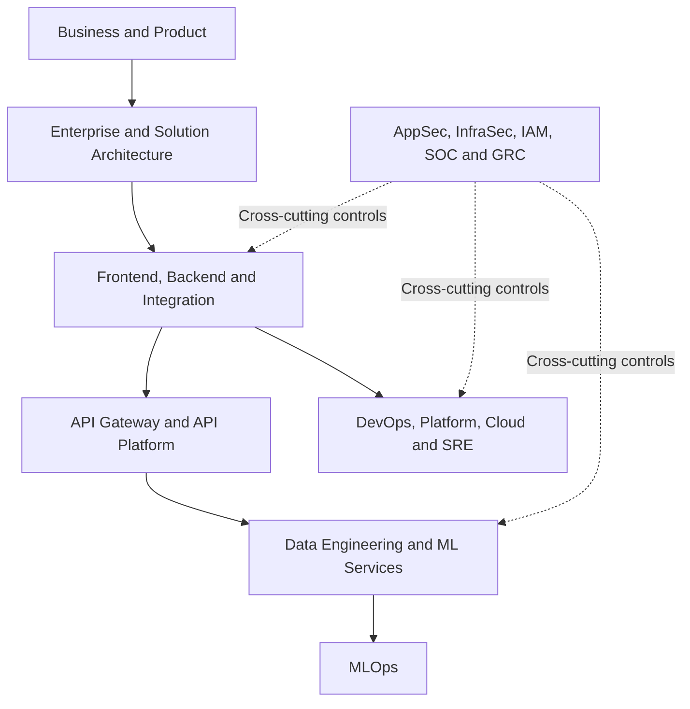

# Enterprise Tech Operating Atlas

> **S1000D-inspired enterprise technology organisation manual** · Issue 001 · Updated 2026-10-13

**Purpose:** Map the technology functions, decision rights, team hierarchy and delivery hand-offs involved in a modern enterprise Python/API/data/ML stack.

**Scope:** 36 functional roles across 5 groups, from Product and Enterprise Architecture through Frontend, Backend, API Platform, Data Science, MLOps, DevOps, SRE, InfoSec and CISO governance.

**Documentation standard:** This is a *S1000D-inspired* human-readable Markdown manual. Identifiers (for example, `ITM-ORG-005`) are local reference codes, **not compliant S1000D Data Module Codes or S1000D XML**. The writing aims at concise controlled English, but is not a certified ASD-STE100 implementation.

## Interactive operational atlas

**[Open the interactive browser interface](index.html)** — Search 36 roles, inspect hierarchy and escalation, trace 13 connected services, navigate CORS / 502 / reporting / ML drift incidents, and generate draft RACI and change-impact checklists.

- [Interactive guide](modules/ITM-ORG-009-interactive-guide.md)
- [Structured reference graph](data/atlas.json) (JSON)
- [Atlas validator](scripts/validate_atlas.py) (Python standard library)
- [GitHub Actions validation](../../.github/workflows/validate-enterprise-tech-atlas.yml) (repository-root workflow; path shown for reference)

**Local launch** (from repository root):

```bash
python -m http.server 8000
```

Then open `http://localhost:8000/manuals/enterprise-tech-operating-atlas/`. Publishing via GitHub Pages requires the repository's Pages settings or a Pages deploy workflow; committing a static page does not automatically publish it.

## Data module index

| Local module ID | Description |
|---|---|
| ITM-ORG-004 | [Architecture and lifecycle map](modules/ITM-ORG-004-architecture.md) |
| ITM-ORG-005 | [36-role function and hierarchy register](modules/ITM-ORG-005-role-register.md) |
| ITM-ORG-006 | [Authority and organisational hierarchy](modules/ITM-ORG-006-authority.md) |
| ITM-ORG-007 | [RACI, controls and incident pathways](modules/ITM-ORG-007-raci-and-escalation.md) |
| ITM-WEB-CORS-001 | [CORS and API Platform ownership](modules/ITM-WEB-CORS-001.md) |
| ITM-ORG-008 | [Active recall workbook](modules/ITM-ORG-008-active-recall.md) |
| ITM-ORG-009 | [Interactive exploration, dependency and impact guide](modules/ITM-ORG-009-interactive-guide.md) |

## The five organisational groups

| Group | Discipline | Count |
|---|---|---:|
| ORG-01 | Business & Architecture | 7 |
| ORG-02 | Application & API Engineering | 6 |
| ORG-03 | Data, Analytics & ML | 8 |
| ORG-04 | Infrastructure, Cloud & Operations | 7 |
| ORG-05 | Information & Cybersecurity | 8 |
| **TOTAL** | **Distinct reference functions (not headcount)** | **36** |

## Mental model



## Case study

All company and scale details are fictional: **IndiaOne Bank**, a hypothetical financial institution with **100 crore (1 billion) customers**. Examples cover a Python FastAPI loan eligibility service, API gateway/CORS, LOS-to-LMS integration and data mart reconciliation. No example represents an actual company's production design.

## Use

1. Start with the [architecture map](modules/ITM-ORG-004-architecture.md) to identify the functional layer.
2. Open the [role register](modules/ITM-ORG-005-role-register.md) to identify job families and illustrative progression.
3. Use the [authority module](modules/ITM-ORG-006-authority.md) to distinguish managerial, technical, product and security decision rights.
4. Use the [RACI/incident module](modules/ITM-ORG-007-raci-and-escalation.md) for project ownership, approvals and escalation.
5. Test understanding with the [active recall workbook](modules/ITM-ORG-008-active-recall.md).

## Operating caveats

- **Role ≠ Team ≠ Department ≠ Person ≠ RACI assignment.** A function can be shared between teams; a person may hold multiple roles.
- **Technical Lead ≠ mandatory people manager.** Staff and Principal engineers may hold broad technical authority outside management.
- **A RACI matrix is contextual.** The service owner, change authority and segregation-of-duties requirements must be confirmed for each organisation.
- **CORS ≠ authentication or authorisation.** CORS is a browser response-access rule; the API remains responsible for protecting customer data.
- **DevOps is a practice as well as a possible job title.** MLOps adds model-specific reproducibility, registry, quality and drift requirements.
- Do not assume every incident needs CISO sign-off. Escalate security exceptions in accordance with the approved policy.

## Sources for terminology

- [S1000D official site](https://s1000d.org/)
- [ASD-STE100 official information](https://asd-ste100.org/)
- [NIST Secure Software Development Framework SP 800-218](https://csrc.nist.gov/pubs/sp/800/218/final)
- [Google Cloud MLOps architecture guide](https://cloud.google.com/architecture/mlops-continuous-delivery-and-automation-pipelines-in-machine-learning)
- [Google SRE](https://sre.google/)

**Interactive status:** Static application files and data are committed. GitHub Pages publication is not enabled by this change. Generated RACI is advisory and requires confirmation.

**Maintenance note:** Amend local modules with a version note, date, identified role owner and reviewed RACI if adopted for a real company.
