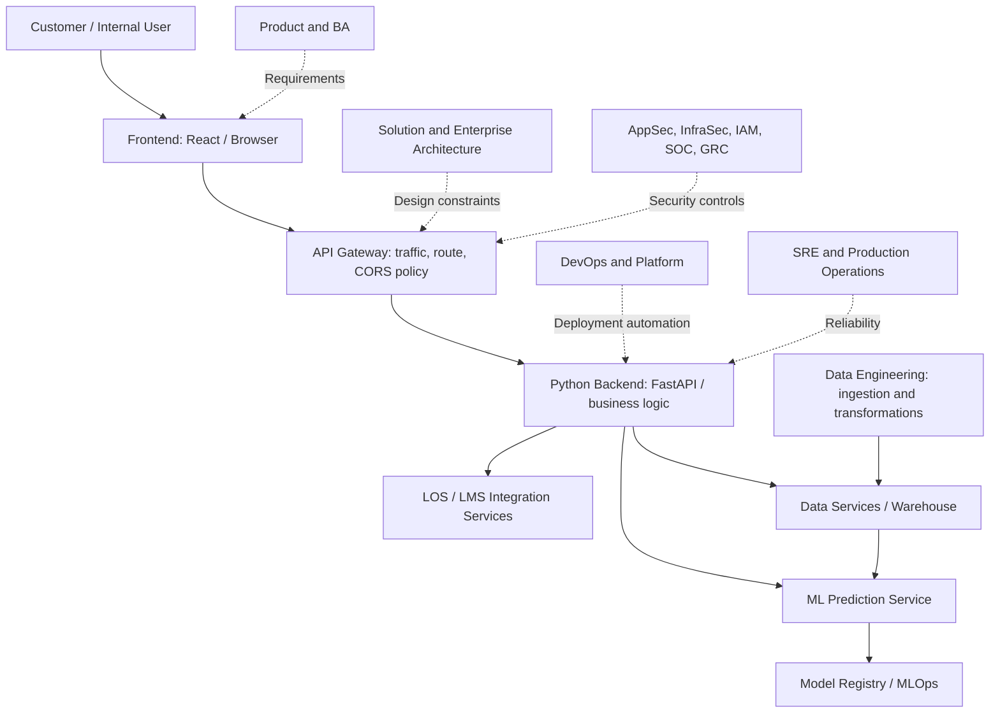

# Data Module ITM-ORG-004 — Technology lifecycle and boundaries

**Issue:** 001  
**Information code:** System description / operating principles  
**Applicability:** Enterprise web and Python API platforms with Data Science and ML  

## 1. Purpose

Identify which teams define, design, build, connect, deploy, secure and operate enterprise applications.

## 2. Architecture (IndiaOne Bank, fictional)

**Reading:** The diagram is a conceptual dependency map, not a strict synchronous execution order. Warehouse data normally feeds curated features through a controlled serving path, not necessarily from a live warehouse query on each customer request.

## 3. Work sequence and ownership

| Step | Function(s) | Output |
|---|---|---|
| Define | Business Owner, Product, BA | Approved requirements and policy rules |
| Design | Enterprise/Solution Architecture, Technical Lead, AppSec | Service design, threat model, integration specifications |
| Build | Frontend, Backend, Integration, Data, DS, ML Engineering | Tested application and model artefacts |
| Connect | API Platform, Integration, Backend | API route, contract, authorisation and version strategy |
| Secure | AppSec, InfraSec, IAM, DevSecOps; SOC/GRC as relevant | Security controls and evidence |
| Deploy | DevOps, Platform Engineering, Cloud, MLOps | CI/CD and model deployment pipelines |
| Operate | SRE, Production Support, Backend, MLOps | SLOs, incident response and drift/quality monitoring |

## 4. Component versus team distinctions

- **API Gateway** is an API traffic component; **API Platform** is the wider capability/team that may own it.
- **Backend** implements the business outcome and API behaviour, including loan-level authorisation checks.
- **DevOps** is a collaborative software-delivery practice and may be a dedicated job family.
- **Platform Engineering** provides reusable internal services for engineering teams.
- **SRE** focuses on reliability targets, operational resilience, incident response and observability.
- **MLOps** extends lifecycle automation to training data, experiments, model registry, deployment and monitoring.
- **InfoSec** is a broad governance/security capability; AppSec, InfraSec, IAM, SOC and GRC are specialised functions.

## 5. Example: a new FOIR eligibility rule

1. Credit Business defines the policy and the effective date.
2. Product and BA specify when the rule applies, exceptions, and audit outcomes.
3. Solution Architect and Backend Lead identify the impacted LOS/decision service.
4. Backend Engineers implement and unit-test the rule; Data Science reviews any model-related feature or cut-off dependency.
5. QA runs SIT; Business conducts UAT; AppSec checks changes that create new exposure.
6. DevOps delivers the authorised release. SRE/Production Support monitors live errors.
7. Data Engineering/Analytics validates downstream eligibility reporting at the correct case/status grain.

**Control:** A user-visible error does not prove frontend ownership. Identify the failed boundary and the configuration owner before assigning remediation.
