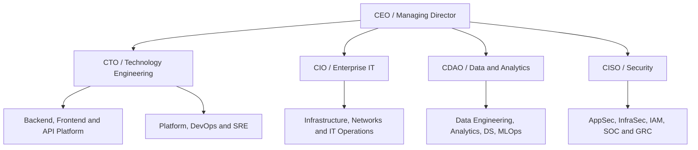

# Data Module ITM-ORG-006 — Hierarchy, decision rights and governance

**Issue:** 001  
**Information code:** Organisation description / decision authority

## 1. Management levels (illustrative)

| Reference level | Title | Typical authority |
|---|---|---|
| L7 | CXO: CTO, CIO, CDAO, CISO, CPO | Enterprise direction, risk appetite, investment strategy |
| L6 | VP / Function Head | Functional strategy, budgets, portfolio targets |
| L5 | Director | Multiple teams or programmes; investment and prioritisation trade-offs |
| L4 | Senior Manager | Multiple workstreams or broader service area |
| L3 | Manager / Engineering Manager | People, delivery, performance, resourcing |
| L2 | Team Lead | Daily assignments and team coordination where designated |
| Parallel IC | Technical Lead / Staff / Principal | Architecture, engineering decisions and design quality |
| L1 / execution grades | Engineer, Analyst, Junior / Associate | Feature and service delivery |

These levels are local teaching codes, **not a standardised global corporate grading framework**. Team Lead and Technical Lead may be the same person or two different people. Senior engineers may carry high technical authority without reports.

## 2. Distinguish four decision rights

| Authority | Accountabilities | Example holder |
|---|---|---|
| Technical | Design, interface constraints, technical correctness | Technical Lead / Architect |
| People | Staffing, coaching and personnel management | Engineering Manager |
| Delivery | Milestones, dependencies, release co-ordination | Manager / Delivery Manager / Director |
| Governance | Security/risk policy, exceptions, compliance | AppSec/GRC authority, CISO or risk delegate |

**Principle:** Approval rights, implementation duties and service accountability can be assigned to separate entities.

## 3. Example reporting model — IndiaOne Bank

This is a **fictional possible structure**, not a recommendation for mandatory CISO reporting. Some organisations place Product with CPO, QA independently, MLOps within engineering, and model validation under a Chief Risk Officer.

## 4. Incident escalation example

A Python FastAPI endpoint behind an API gateway returns **502 Bad Gateway**:

1. On-call/SRE checks logs, upstream health, gateway route and recent deployment.
2. API Platform Lead and Backend Technical Lead identify cause and immediate containment.
3. Team Leads coordinate engineers; service owners maintain operational accountability.
4. Engineering/Operations Managers manage incident communications, staffing and response.
5. Senior Manager/Director resolves disputes and dependencies across platform, application, security and infrastructure.
6. VP/CXO becomes involved under defined severity, regulatory or enterprise impact criteria.

**Non-goal:** The CISO does not personally deploy gateway configuration. Security exception approval follows the applicable delegation and policy.
