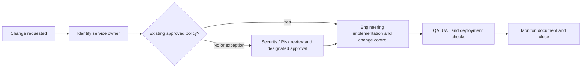

# Data Module ITM-ORG-007 — RACI, change control and fault isolation

**Issue:** 001  
**Information code:** Operational ownership / procedural guidance

## 1. RACI definitions

- **R — Responsible:** Does the work.
- **A — Accountable:** Owns the result and final decision. Prefer one A for the scope defined.
- **C — Consulted:** Provides two-way expertise before relevant decisions.
- **I — Informed:** Receives status, completion or impact notice.

**RACI is not a reporting chart.** It does not describe every formal approval, segregation-of-duties restriction or incident command role.

## 2. Reference ownership matrix

| Activity | Responsible (R) | Accountable (A) | Consulted (C) | Informed (I) |
|---|---|---|---|---|
| Loan rule definition | BA | Credit Product/Process Owner | Credit, Operations | Backend, QA |
| Python API business logic | Backend Engineer | Backend Service Owner | BA, QA, AppSec when relevant | Product |
| API gateway CORS allowlist | API Platform Engineer (if gateway-owned) | API Platform Service Owner | Frontend, Backend, AppSec | Product, Support |
| API versioning and gateway route | API Platform Engineer | API Platform Service Owner | Backend, Integration | QA, Support |
| CI/CD configuration | DevOps Engineer | Platform/Delivery Service Owner | AppSec, Backend | SRE |
| ML development | Data Scientist | Model Owner | Model Validation, Data Engineering | Product |
| Model release automation | MLOps Engineer | ML Platform Owner | ML Engineering, Risk Validation | SRE, Product |
| Network connectivity | Network Engineer | Network/Infrastructure Service Owner | InfraSec, API Platform | Requesting team |
| Business UAT | UAT Tester / QA | Business Product Owner | BA, Engineering | Operations |

The assignments are **examples**. A business-specific RACI must identify the exact service and approval scope before adoption.

## 3. Approval pathway

Only security policy exceptions or other defined high-risk cases require the specified additional approval. Avoid universal CISO sign-off for routine changes.

## 4. Fault-owner lookup

| Symptom | Initial investigators | What to verify |
|---|---|---|
| Browser CORS blocked | Frontend + CORS policy owner | Origin, OPTIONS preflight, allowed headers/methods and response policy |
| Gateway 502/504 | API Platform + Backend + SRE | Upstream route, service health, network and timeouts |
| Incorrect Python eligibility decision | Backend + Product/BA | Rule implementation, input mapping and version |
| Cross-service connectivity fails | Network/Infrastructure + API Platform | DNS, firewall, routes, certificate/trust and service exposure |
| GitHub Actions pipeline fails | DevOps/Platform + repo maintainers | Build logs, runner identity, permissions, artifact |
| Incorrect pipeline features | Data Engineering + Analytics/DS | Grain, lineage, effective dates and joins |
| Model output degrades | Data Science + MLOps | Drift, ground truth, inference health and threshold policy |
| Suspicious credential activity | IAM + SOC | Identity events, scope, containment and response |

## 5. LOS → LMS → reporting: returned-case example

**Event:** A loan case returns to an earlier LOS state and is missing from LMS reporting.

1. **Business / Product / BA:** Is the case *supposed* to be in LMS in this state? Establish the process rule.
2. **LOS Backend:** Did LOS produce the required event or API request? Check status and effective timestamps.
3. **Integration / API Platform:** Did middleware or gateway send the event? Check failures, retries and schema mapping.
4. **LMS Backend:** Did LMS accept, reject, reverse or ignore the event? Check idempotency and state transitions.
5. **Data Engineering / Analytics:** Does the mart reflect operational truth at the right event/case grain? Check latency, joins and missing events.
6. **QA / Product Owner:** Confirm the expected business journey and regression test.

Possible classification: **process expectation gap**, **integration defect**, **state-mapping defect**, or **reporting reconciliation defect**. Do not assign a root cause based solely on the team where the symptom is visible.

## 6. Practical change-control fields

Document: change ID; requestor; process owner; impacted service and environment; technical owner; security impact; business impact; approved origin/domain where applicable; rollback plan; UAT/SIT evidence; release time; observability/alert owner; sign-off; post-release validation.
